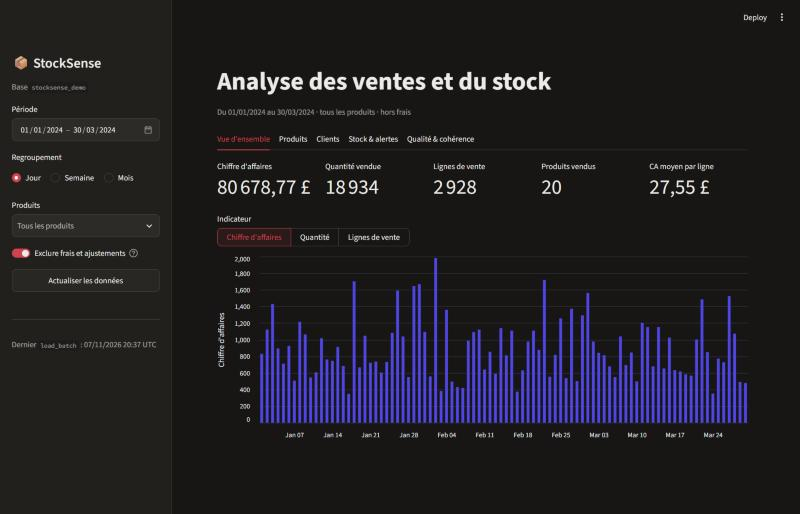
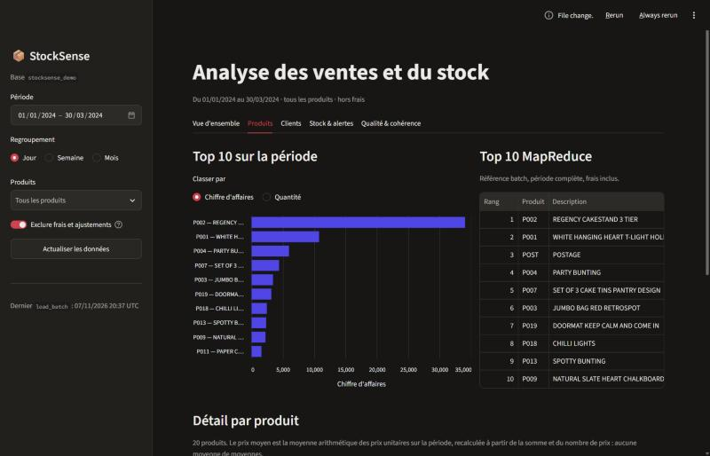
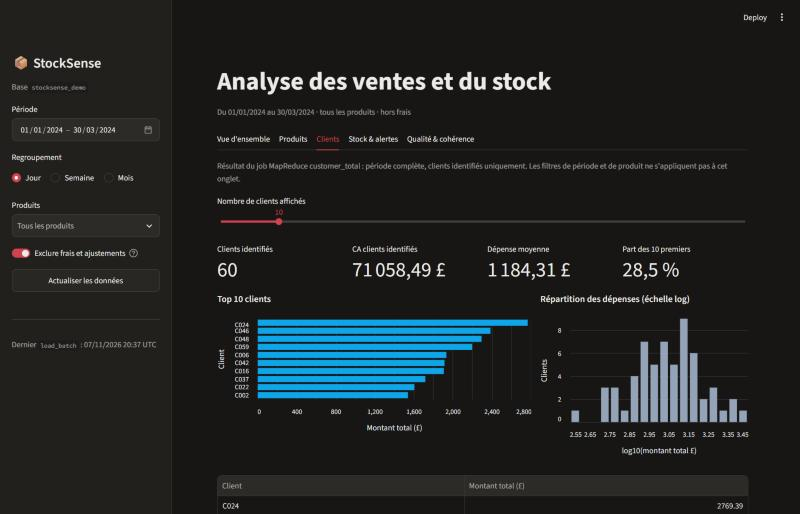
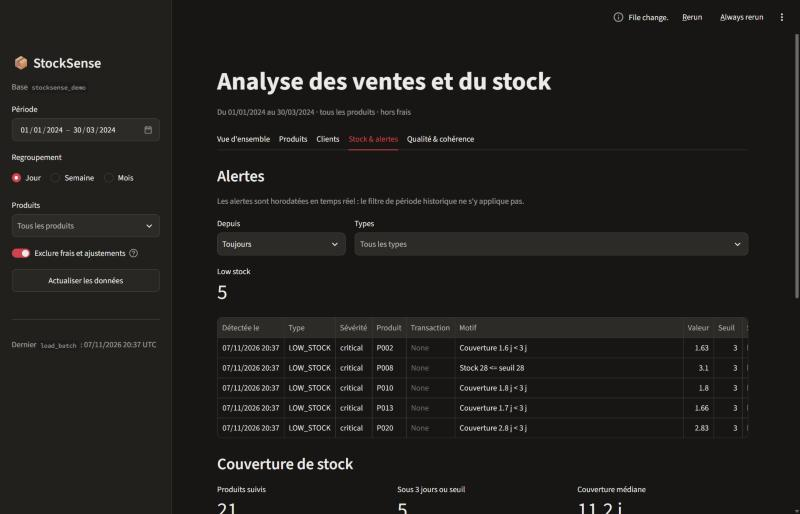
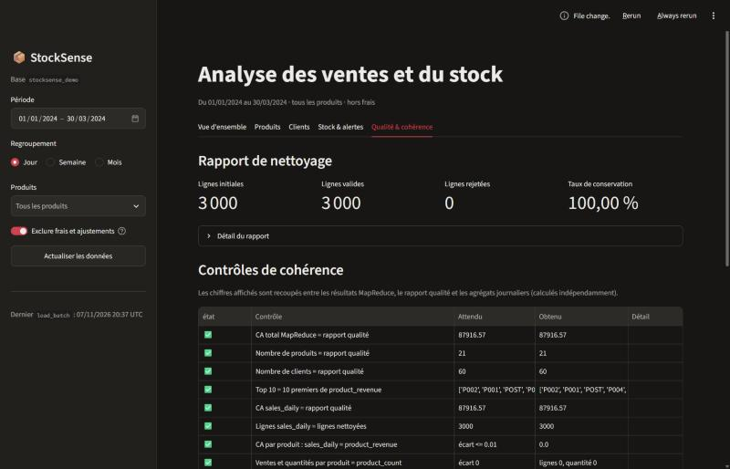

# StockSense – Guide utilisateur du dashboard

Le dashboard présente les ventes, les produits, les clients, le stock et les
alertes calculés par la chaîne batch (Hadoop MapReduce) et le flux temps réel
(Kafka / Spark), à partir de MongoDB.

Lancement : voir le [README](../README.md#5-démarrage-rapide). Adresse par
défaut : <http://localhost:8501>.

## 1. Filtres (barre latérale)

| Filtre | Effet | Onglets concernés |
|---|---|---|
| **Période** | Bornes incluses, jour par jour. Limitée aux dates présentes dans les données | Vue d'ensemble, Produits |
| **Regroupement** | Jour, semaine (lundi → dimanche) ou mois pour le graphique de ventes | Vue d'ensemble |
| **Produits** | Restreint tous les indicateurs aux références choisies (recherche par code ou description) | Vue d'ensemble, Produits, Stock & alertes |
| **Exclure frais et ajustements** | Retire `POST`, `DOT`, `M`, `BANK CHARGES`… qui ne sont pas des articles. Sans effet quand des produits sont sélectionnés | Vue d'ensemble, Produits |
| **Actualiser les données** | Vide le cache (60 s par défaut) pour relire MongoDB immédiatement | Tous |

Le bandeau sous le titre rappelle toujours les filtres actifs. En bas de la
barre latérale, la date du dernier chargement indique la fraîcheur des données.

## 2. Onglets

### Vue d'ensemble
- **Chiffre d'affaires, quantité, lignes de vente, produits vendus, CA moyen
  par ligne** sur la période.
- Les flèches de variation comparent à la **période précédente de même
  durée** (ex. mars comparé à février). Elles n'apparaissent que si cette
  période précédente existe dans les données.
- Graphique : CA, quantité ou nombre de lignes par jour, semaine ou mois.

### Produits

- **Top 10 sur la période** : classement par CA ou par quantité, avec filtres.
- **Top 10 MapReduce** : résultat de référence du job `top10`, sur toute la
  période et frais inclus. Il diffère du classement de gauche si la période
  est réduite ou si les frais sont exclus : c'est attendu.
- **Détail par produit** : lignes, quantité, CA et prix moyen. Le prix moyen
  est la moyenne arithmétique des prix unitaires, recalculée sans faire de
  moyenne de moyennes.

### Clients

- Issu du job `customer_total` : **période complète, clients identifiés
  seulement** (les ventes sans `customer_id` sont exclues). Les filtres de
  période et de produit ne s'appliquent pas à cet onglet ; c'est indiqué en
  haut de l'onglet.
- Curseur pour afficher les 5 à 50 meilleurs clients, part du CA qu'ils
  représentent et répartition des dépenses (échelle logarithmique : quelques
  très gros clients écrasent sinon le graphique).

### Stock & alertes

- **Alertes** : les plus récentes d'abord, avec leur **motif** (ex. « Couverture
  1,6 j < 3 j », « quantité 500 > seuil 100 »). Filtrables par ancienneté et
  par type. Elles sont horodatées en temps réel, donc le filtre de période
  historique ne s'y applique pas.
- **Couverture de stock** = stock disponible / ventes moyennes journalières
  (30 derniers jours). Un produit est à réapprovisionner si sa couverture est
  inférieure à 3 jours ou si son stock atteint le seuil. Le bouton permet
  d'afficher tous les produits.
- **Flux temps réel** : CA par fenêtre de streaming (Spark). Vide tant que le
  producteur Kafka et le job Spark ne tournent pas.

### Qualité & cohérence

- Rapport de nettoyage : lignes lues, valides, rejetées.
- **Contrôles de cohérence** : les chiffres sont recoupés entre MapReduce, le
  rapport qualité et les agrégats journaliers. Tous doivent être ✅. Un ❌
  signale un chargement partiel ou incohérent : relancer
  `python -m database.load_batch …` puis `python -m database.verify`.
- Nombre de documents par collection MongoDB.

## 3. Données absentes

Le dashboard reste utilisable quand une partie des données manque. Il affiche
alors un message et la commande à lancer :

| Situation | Affichage |
|---|---|
| MongoDB arrêté | Page d'erreur avec les commandes de démarrage |
| Seuls les résultats MapReduce sont chargés | Totaux globaux ; filtres de période désactivés |
| Aucune vente pour les filtres choisis | Message « Aucune vente sur cette période » |
| Pas d'inventaire / pas de streaming | Message dans la section concernée |

## 4. Scénario de démonstration

1. Montrer la **Vue d'ensemble** sur toute la période, puis réduire la période
   à un mois : les KPI et les variations changent.
2. Sélectionner un produit du Top 10 : vérifier que son CA dans *Produits*
   correspond à la valeur MapReduce lorsque la période est complète.
3. Onglet **Stock & alertes** : produits sous 3 jours de couverture.
4. Lancer le producteur Kafka, injecter une vente anormale (Étudiant 2), cliquer
   sur **Actualiser les données** : la nouvelle alerte apparaît en tête avec son motif.
5. Onglet **Qualité & cohérence** : tous les contrôles sont ✅.
